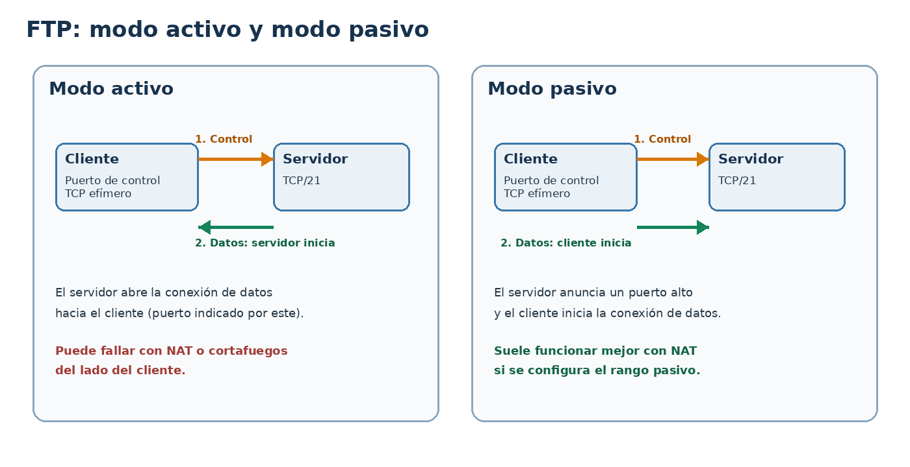

# Servicio FTP en redes

## 1. Objetivos

- Explicar cómo funciona FTP y diferenciarlo de FTPS y SFTP.
- Identificar los canales de control y de datos.
- Diferenciar los modos activo y pasivo.
- Instalar, configurar y administrar un servidor FTP.
- Crear usuarios, limitar su acceso y aplicar permisos adecuados.
- Comprobar el funcionamiento desde un cliente y diagnosticar errores habituales.
- Reconocer los riesgos de seguridad de FTP sin cifrar.

## 2. ¿Qué es FTP?

FTP (*File Transfer Protocol*) es un protocolo de aplicación utilizado para transferir archivos entre un cliente y un servidor a través de una red TCP/IP. Permite operaciones como listar directorios, descargar archivos, subir archivos y cambiar de directorio, siempre dentro de los permisos concedidos.

En una instalación típica:

- **Cliente FTP:** programa que inicia la sesión y solicita operaciones. Ejemplos: FileZilla, `lftp` o clientes FTP de línea de comandos.
- **Servidor FTP:** servicio que escucha conexiones y aplica las reglas de autenticación, acceso y transferencia. En Linux se pueden utilizar `vsftpd` o ProFTPD.
- **Sistema de archivos:** los archivos y directorios reales del servidor. El acceso depende tanto de la configuración del servicio como de los permisos del sistema operativo.


## 3. Cómo funciona FTP

FTP utiliza TCP y separa la comunicación en dos tipos de conexión:

1. **Canal de control:** se utiliza para enviar órdenes y recibir respuestas. Tradicionalmente escucha en el puerto TCP 21 del servidor.
2. **Canal de datos:** se utiliza para transferir archivos y listados de directorios. La conexión que se usa depende del modo activo o pasivo.

Por ello, permitir únicamente el puerto TCP 21 en el cortafuegos puede no ser suficiente para transferir archivos.

### 3.1. Órdenes y respuestas

El cliente envía órdenes al servidor, que responde con códigos numéricos y mensajes. Algunos ejemplos de órdenes son:

- `USER`: indica el nombre de usuario.
- `PASS`: envía la contraseña.
- `PWD`: muestra el directorio actual.
- `LIST`: solicita un listado.
- `RETR`: descarga un archivo.
- `STOR`: sube un archivo.
- `CWD`: cambia de directorio.
- `QUIT`: termina la sesión.

Los códigos de respuesta ayudan a interpretar el resultado. Por ejemplo, `220` suele indicar que el servicio está preparado, `230` que el inicio de sesión se ha realizado correctamente, `530` que el inicio de sesión no está permitido y `550` que una operación sobre un archivo o directorio no se puede realizar.

## 4. Modo activo y modo pasivo



### Modo activo

El cliente establece el canal de control con el servidor. Después indica un puerto en el que espera la conexión de datos y el **servidor inicia** esa conexión hacia el cliente. Esto puede dar problemas si el cliente está detrás de NAT o de un cortafuegos que bloquea conexiones entrantes.

### Modo pasivo

El cliente solicita el modo pasivo. El servidor indica un puerto para datos y el **cliente inicia** la conexión hacia ese puerto del servidor. Es el modo más habitual en clientes actuales porque suele adaptarse mejor a redes con NAT.

En un servidor detrás de un cortafuegos, hay que configurar un rango de puertos pasivos y permitirlo en el cortafuegos. Si el servidor está detrás de NAT, también puede ser necesario configurar la dirección pública anunciada por el servicio y redirigir ese rango en el router.

## 5. FTP, FTPS y SFTP

Aunque los nombres se parecen, no son equivalentes.

| Protocolo | Funcionamiento | Seguridad |
|---|---|---|
| FTP | Protocolo FTP clásico sobre TCP | No cifra credenciales ni datos |
| FTPS | FTP protegido mediante TLS | Cifra la sesión si TLS está correctamente configurado |
| SFTP | Transferencia de archivos sobre SSH | Utiliza el canal cifrado de SSH; no es FTP con TLS |

**Importante:** FTP sin cifrar no debe utilizarse para transferir credenciales o información sensible en redes no confiables. En entornos reales se debe priorizar un protocolo seguro, como SFTP o FTPS, según los requisitos del servicio. Para aprender el funcionamiento de FTP clásico, se puede utilizar una red de laboratorio aislada y credenciales de prueba.

## 6. Instalar un servidor FTP con vsftpd

`vsftpd` (*Very Secure FTP Daemon*) es un servidor FTP disponible en las distribuciones Debian y Ubuntu. Los comandos siguientes están pensados para un servidor Debian/Ubuntu reciente. Los nombres de paquetes y rutas pueden variar en otras distribuciones.

### 6.1. Instalar el paquete

Actualiza el índice de paquetes e instala el servicio:

```bash
sudo apt update
sudo apt install vsftpd
```

Comprueba su estado:

```bash
sudo systemctl status vsftpd
```

Para iniciar, detener, reiniciar o habilitar el servicio al arrancar:

```bash
sudo systemctl start vsftpd
sudo systemctl stop vsftpd
sudo systemctl restart vsftpd
sudo systemctl enable vsftpd
```

`restart` aplica la configuración reiniciando el proceso. Después de modificar el archivo de configuración, comprueba siempre el estado del servicio.

### 6.2. Guardar una copia de la configuración

El archivo principal suele ser `/etc/vsftpd.conf`. Antes de editarlo, guarda una copia:

```bash
sudo cp /etc/vsftpd.conf /etc/vsftpd.conf.bak
```

Edita el archivo con un editor de texto, por ejemplo:

```bash
sudo nano /etc/vsftpd.conf
```

Las opciones pueden aparecer comentadas con `#`. Para que tengan efecto, deben estar activadas y no duplicadas de forma contradictoria.

## 7. Configuración básica de vsftpd

Para una práctica con usuarios locales y acceso de escritura controlado, revisa estas opciones en `/etc/vsftpd.conf`:

```ini
listen=NO
listen_ipv6=YES

anonymous_enable=NO
local_enable=YES
write_enable=YES

local_umask=022
dirmessage_enable=YES
use_localtime=YES
xferlog_enable=YES

connect_from_port_20=YES
```

Notas importantes:

- `anonymous_enable=NO` deshabilita el acceso anónimo.
- `local_enable=YES` permite autenticar usuarios locales del sistema.
- `write_enable=YES` habilita operaciones de escritura que luego siguen sujetas a permisos y restricciones.
- `local_umask=022` establece una máscara para los permisos de los archivos creados por usuarios locales; el resultado concreto depende también de los permisos solicitados por la aplicación.
- `listen` y `listen_ipv6` controlan el tipo de escucha. En muchas instalaciones Debian/Ubuntu la configuración predeterminada utiliza escucha IPv6 con soporte dual, pero hay que revisar el archivo instalado y evitar activar simultáneamente modos de escucha incompatibles.

Esta configuración es un punto de partida didáctico, **no una configuración segura completa para exponer el servicio a Internet**. No habilites el acceso anónimo ni abras el servicio a redes externas sin una política de seguridad definida.

### 7.1. Configurar modo pasivo

Añade o ajusta un rango de puertos pasivos, por ejemplo:

```ini
pasv_min_port=40000
pasv_max_port=40100
```

El rango es un ejemplo para el laboratorio. Si hay un cortafuegos, permite TCP/21 y el rango TCP/40000–40100 solo desde las redes que deban acceder. Si hay NAT, configura también las redirecciones correspondientes. No abras puertos indiscriminadamente.

### 7.2. Reiniciar y comprobar

```bash
sudo systemctl restart vsftpd
sudo systemctl --no-pager --full status vsftpd
sudo ss -ltnp | grep -E ':21\\b'
```

Si el servicio no arranca, revisa el estado y los registros:

```bash
sudo journalctl -u vsftpd --no-pager -n 50
```

## 8. Crear usuarios y preparar directorios

Para evitar usar una cuenta administrativa, crea un usuario específico para la práctica:

```bash
sudo adduser cliftp
```

Asigna una contraseña de prueba  
**ftp_1234**  
El usuario tendrá una cuenta local, por lo que debes considerar también sus permisos y el acceso que pueda tener fuera del servicio FTP.

### 8.1. Permisos Linux

FTP no sustituye el sistema de permisos de Linux. Para leer un archivo, el usuario debe tener permisos de lectura; para listar un directorio necesita los permisos correspondientes; y para subir o borrar archivos se requieren permisos de escritura adecuados en el directorio.

Crea un directorio de intercambio propiedad del usuario:

```bash
sudo mkdir -p /srv/ftp/intercambio
sudo chown cliftp:cliftp /srv/ftp/intercambio
sudo chmod 750 /srv/ftp/intercambio
```

Este ejemplo permite al usuario propietario acceder al directorio y restringe el acceso a otros usuarios. Ajusta propietario, grupo y permisos a los objetivos de la práctica; evita `chmod 777` como solución genérica.

### 8.2. Limitar usuarios a su directorio

Para que los usuarios locales queden confinados a su directorio personal, `vsftpd` ofrece la opción:

```ini
chroot_local_user=YES
```

Sin embargo, hay que diseñar correctamente la propiedad y los permisos de los directorios. En particular, no es recomendable hacer escribible por el propio usuario la raíz del entorno `chroot` sin revisar las restricciones de seguridad de `vsftpd`. Una solución habitual es que la raíz confinada pertenezca a `root` y no sea escribible por el usuario, con un subdirectorio separado donde sí pueda escribir.

Por ejemplo, como esquema de permisos:

```bash
sudo chown root:root /home/cliftp
sudo chmod 755 /home/cliftp
sudo mkdir -p /home/cliftp/archivos
sudo chown cliftp:cliftp /home/cliftp/archivos
sudo chmod 750 /home/cliftp/archivos
```

Antes de aplicar este esquema a un usuario existente, comprueba el contenido de su directorio personal y asegúrate de no alterar archivos que necesite. Para una práctica real, verifica también que la configuración de `vsftpd` y la distribución permitan el confinamiento esperado.

## 9. Probar el servicio desde un cliente

Realiza las pruebas desde otra máquina de la red.

### 9.1. Comprobar conectividad

```bash
ping -c 4 192.168.20.5
```

El ping puede estar bloqueado aunque el servicio FTP funcione. Comprueba también el puerto de control:

```bash
nc -vz 192.168.20.5 21
```

### 9.2. Conectarse desde línea de comandos

Si el cliente dispone de `lftp`:

```bash
lftp -u cliftp 192.168.20.5
```

El programa solicitará la contraseña si no se indica en la línea de órdenes. Dentro de la sesión se pueden probar órdenes como:

```text
pwd
ls
cd archivos
put prueba.txt
get prueba.txt
bye
```

La subida solo funcionará si el usuario tiene permisos de escritura en el directorio remoto. En FTP sin TLS las credenciales y los datos pueden viajar sin cifrar.

También puedes configurar FileZilla con el protocolo correcto, la IP del servidor, el usuario y la contraseña. Si estás practicando FTP clásico, selecciona FTP explícitamente; no lo confundas con SFTP. Para un entorno real, utiliza FTPS o SFTP según el servicio que se haya desplegado.

## 10. Registros y diagnóstico

Los registros permiten detectar errores de autenticación, permisos o conexiones. En sistemas con `systemd`:

```bash
sudo journalctl -u vsftpd --since "10 minutes ago"
```

Según la configuración, `vsftpd` puede escribir también un registro de transferencias, por ejemplo `/var/log/vsftpd.log` o `/var/log/xferlog`. Comprueba las opciones activadas y los archivos presentes en la distribución.

### Problemas frecuentes

| Síntoma | Posibles causas | Comprobaciones |
|---|---|---|
| No conecta al puerto 21 | Servicio parado, IP incorrecta, cortafuegos | `systemctl status vsftpd`, `ss -ltnp`, reglas de firewall |
| Autenticación rechazada | Usuario o contraseña incorrectos, usuarios restringidos, cuenta bloqueada | Revisar credenciales de prueba, configuración y registros |
| Puede listar pero no subir | `write_enable` desactivado o permisos Linux insuficientes | Revisar `vsftpd.conf`, propietario y permisos del directorio |
| Inicia sesión pero no lista o transfiere | Problema con el canal de datos, modo activo/pasivo o puertos bloqueados | Usar modo pasivo y comprobar el rango configurado |
| El servicio no arranca | Error de sintaxis o directivas incompatibles | `journalctl -u vsftpd` y revisar el archivo de configuración |
| El usuario puede ver más archivos de los previstos | Confinamiento no configurado o permisos demasiado amplios | Revisar `chroot_local_user` y permisos de directorios |

## 11. Seguridad: lista de comprobación

Antes de dar por terminado un despliegue, comprueba:

- [ ] El acceso anónimo está desactivado salvo que exista una necesidad justificada.
- [ ] Se utilizan cuentas específicas y contraseñas robustas.
- [ ] Los usuarios solo pueden acceder a los directorios necesarios.
- [ ] Los permisos Linux son mínimos y no se utiliza `777` como solución general.
- [ ] El cortafuegos permite solo los puertos y orígenes necesarios.
- [ ] El rango pasivo está configurado y limitado si se utiliza ese modo.
- [ ] Se utiliza FTPS o SFTP cuando las credenciales o los datos deban protegerse.
- [ ] Se revisan los registros y se mantienen el sistema y el servidor actualizados.


